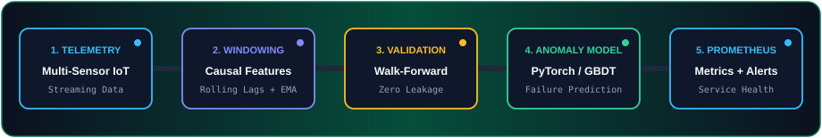

 <div align="center">
  

  <br/>

  
  
  
  
  
  
  
</div>

---

## 📌 Overview

**PredictiveOps** is a time-series Machine Learning and MLOps platform designed to detect abnormal industrial sensor behavior and support predictive maintenance by identifying potential equipment degradation before failure.

The project combines causal rolling-window feature engineering, point-in-time-correct data processing, walk-forward temporal validation, model evaluation, and monitored inference serving to build a reproducible pipeline for industrial IoT telemetry.

Its architecture is designed around two complementary objectives: **anomaly detection** for identifying unusual equipment behavior and **Remaining Useful Life (RUL) prediction** when suitable equipment lifecycle and failure labels are available.

### ✨ Key Highlights

- 📡 Multivariate industrial sensor telemetry processing
- 📈 Causal lag features, rolling statistics, and exponential moving averages
- 🔒 Point-in-time correctness and future-data leakage prevention
- 🔬 Walk-forward temporal cross-validation
- 🧠 Anomaly detection and supervised RUL modeling workflows
- ⚡ API-based model inference
- 📊 Prometheus metrics for service health and latency monitoring
- 🐳 Docker-based deployment and reproducible execution
- 🧪 Automated tests and CI pipeline integration

---

## 🏗️ System Architecture

```mermaid
flowchart LR
    Sensor["Multi-Sensor IoT<br/>Telemetry Stream"]
    Ingest["Data Ingestion<br/>& Validation"]
    Features["Causal Rolling-Window<br/>Feature Engineering"]
    Store[("Point-in-Time<br/>Feature Pipeline")]
    Validation["Walk-Forward<br/>Temporal Validation"]
    Models["Anomaly Detection<br/>& RUL Prediction"]
    API["Inference API<br/>FastAPI"]
    Monitor["Prometheus<br/>Metrics & Monitoring"]
    Alerts["Configurable<br/>Early-Warning Alerts"]

    Sensor --> Ingest
    Ingest --> Features
    Features --> Store
    Store --> Validation
    Validation --> Models
    Models --> API
    API --> Monitor
    Monitor --> Alerts

    style Sensor fill:#070b14,stroke:#00E7FF,stroke-width:2px,color:#ffffff
    style Ingest fill:#0f172a,stroke:#3B82F6,stroke-width:2px,color:#ffffff
    style Features fill:#0f172a,stroke:#3B82F6,stroke-width:2px,color:#ffffff
    style Store fill:#0f172a,stroke:#8B5CF6,stroke-width:2px,color:#ffffff
    style Validation fill:#0f172a,stroke:#F59E0B,stroke-width:2px,color:#ffffff
    style Models fill:#0f172a,stroke:#00E7FF,stroke-width:2px,color:#ffffff
    style API fill:#0f172a,stroke:#10B981,stroke-width:2px,color:#ffffff
    style Monitor fill:#0f172a,stroke:#10B981,stroke-width:2px,color:#ffffff
    style Alerts fill:#070b14,stroke:#10B981,stroke-width:2px,color:#ffffff
```

<div align="center">
  
</div>



*Architecture overview: the diagram represents the intended end-to-end design. Individual components should be considered implemented only when supported by the repository code and tests.*

---

## 🎯 Project Objectives

- Detect abnormal equipment behavior using multivariate sensor telemetry.
- Engineer time-aware features from configurable historical windows.
- Prevent lookahead bias and data leakage during training and evaluation.
- Evaluate predictive performance using chronological validation.
- Estimate equipment Remaining Useful Life when appropriate lifecycle labels exist.
- Serve model predictions through an inference API.
- Monitor inference latency, request volume, service health, and prediction behavior.
- Establish a reproducible foundation for industrial predictive maintenance.

---

## 🔧 Core ML & MLOps Engineering

### 1. Causal Rolling-Window Feature Engineering

Transforms raw sensor observations into time-aware features that capture historical equipment behavior.

**Feature examples:**

- Lag features from previous observations.
- Rolling means and standard deviations.
- Exponential moving averages (EMA).
- Sensor rate-of-change and first differences.
- Rolling minimums, maximums, and quantiles.
- Configurable historical windows, such as `1h`, `6h`, and `24h`, where appropriate for the sampling frequency.

**Engineering considerations:**

- Every feature must use only observations available at its prediction timestamp.
- Window boundaries and timestamp alignment must be explicit.
- Missing sensor readings must be handled consistently.
- Feature transformations should be tested against hand-calculated examples.
- Training and inference should use consistent feature definitions.

### 2. Leak-Free Walk-Forward Temporal Validation

Uses chronological validation instead of relying on random train-test splits for time-dependent prediction tasks.

**Workflow:**

1. Train on historical observations.
2. Validate on a later time interval.
3. Advance the cutoff and repeat.
4. Fit preprocessing transformations using training data only.
5. Apply an appropriate gap or embargo when overlapping windows or delayed labels could introduce leakage.
6. Reserve a final chronological test period for unbiased evaluation.

This approach helps reduce lookahead bias and provides a more realistic assessment of future performance.

### 3. Anomaly Detection

Identifies unusual sensor behavior that may indicate abnormal operating conditions or emerging equipment issues.

**Potential modeling approaches:**

- Statistical threshold-based baselines.
- Isolation Forest.
- Reconstruction-error-based anomaly detection.
- PyTorch-based models when their complexity is justified.

**Evaluation metrics:**

- Precision and recall when reliable anomaly labels are available.
- False alarm rate.
- Detection delay.
- Anomaly score distributions.
- Operational alert volume.

For unlabeled data, proxy labels and manually reviewed events should be documented along with their limitations.

### 4. Remaining Useful Life (RUL) Prediction

RUL estimation is a separate supervised prediction task that estimates the remaining time or operating cycles before equipment failure.

**Implementation approach:**

- Define the target using appropriate lifecycle and failure information.
- Establish simple regression baselines.
- Compare suitable machine learning or temporal models.
- Evaluate performance across chronological splits and equipment units.
- Analyze errors across operating conditions and prediction horizons.

**Important:** An anomaly score alone is not a reliable RUL estimate. This capability requires an appropriate target, suitable labels, and a separate evaluation protocol.

### 5. Point-in-Time-Correct Feature Pipeline

Maintains consistent feature definitions across training and inference.

- Prevents future observations from entering historical feature calculations.
- Tracks timestamps and equipment identifiers.
- Reuses feature transformations across pipeline stages.
- Tests for data leakage and inconsistent feature generation.
- Helps reduce training-serving skew.

A dedicated feature-store product is optional for the initial implementation; a versioned, tested feature pipeline can establish these principles.

### 6. Monitored Inference & Early-Warning Alerts

Integrates model inference with application-level observability.

**Monitoring capabilities can include:**

- Request counters and prediction latency.
- Service availability and error rates.
- Missing-value rates and sensor input validation.
- Anomaly score distributions and alert volumes.
- Model-quality metrics when delayed ground truth becomes available.

Prometheus can collect exposed service metrics. Configurable thresholds and alert rules should be evaluated against historical data to control excessive false alarms.

---

## 🧰 Technology Stack

| Category | Technologies |
|---|---|
| Language | Python 3.11 |
| Data Processing | Pandas, NumPy |
| Machine Learning | Scikit-learn, PyTorch |
| Feature Engineering | Lag features, rolling statistics, EMA |
| Model Validation | Walk-forward temporal validation |
| API Serving | FastAPI, Uvicorn |
| Monitoring | Prometheus |
| Testing | Pytest |
| CI/CD | GitHub Actions |
| Containerization | Docker, Docker Compose |
| Version Control | Git, GitHub |

*The final stack should reflect the dependencies and integrations actually implemented in the repository.*

---

## 📂 Repository Structure

```text
PredictiveOps/
├── api/
│   └── main.py
├── src/
│   ├── data/
│   │   ├── generate_sensor_data.py
│   │   └── telemetry.py
│   ├── windowing/
│   │   └── features.py
│   ├── validation/
│   │   └── walk_forward.py
│   └── models/
│       ├── train.py
│       ├── anomaly.py
│       └── rul.py
├── tests/
│   ├── test_features.py
│   ├── test_validation.py
│   └── test_api.py
├── assets/
│   ├── predictive-banner.svg
│   └── predictive-pipeline.svg
├── requirements.txt
├── Dockerfile
├── docker-compose.yml
├── README.md
├── LICENSE
└── .github/
    └── workflows/
        └── ci.yml
```

*This is a suggested structure combining data generation, feature engineering, validation, modeling, and serving. Keep only files and modules that exist in the actual codebase.*

---

## 🚀 Quickstart & Local Execution

### Prerequisites

- Python 3.11
- Git
- A terminal such as PowerShell, Command Prompt, or Bash

### 1. Clone the Repository

```bash
git clone https://github.com/Aditya70-creator/PredictiveOps.git
cd PredictiveOps
```

### 2. Create a Virtual Environment

**Windows PowerShell**

```powershell
python -m venv .venv
.\.venv\Scripts\Activate.ps1
```

**Linux / macOS**

```bash
python3 -m venv .venv
source .venv/bin/activate
```

### 3. Install Dependencies

```bash
python -m pip install --upgrade pip
pip install -r requirements.txt
```

### 4. Generate Sensor Telemetry

```bash
python -m src.data.generate_sensor_data
```

### 5. Train the Model

```bash
python -m src.models.train
```

### 6. Run Tests

```bash
pytest -v
```

### 7. Start the Inference API

```bash
uvicorn api.main:app --reload --port 8000
```

Once the server is running, access the API documentation:

- **Swagger UI:** [http://127.0.0.1:8000/docs](http://127.0.0.1:8000/docs)
- **ReDoc:** [http://127.0.0.1:8000/redoc](http://127.0.0.1:8000/redoc)

*The commands assume these modules and entry points exist and are configured as shown. Update them to match the actual implementation.*

---

## 🐳 Containerization

For a containerized workflow, the project can use Docker to package the inference API and Docker Compose to orchestrate the application and monitoring services.

**Example commands, once the corresponding configuration files are implemented:**

```bash
docker compose build
docker compose up -d
docker compose logs -f
docker compose down
```

A production-oriented setup should include dependency pinning, health checks, environment-based configuration, and appropriate resource limits.

---

## 📊 Evaluation Metrics

| Metric | Purpose |
|---|---|
| **Precision** | Fraction of predicted anomalies that are genuine |
| **Recall** | Fraction of known anomalies detected |
| **False Alarm Rate** | Frequency of false anomaly alerts |
| **Detection Delay** | Time between anomaly onset and detection |
| **MAE** | Average absolute error for RUL predictions |
| **RMSE** | Penalizes larger RUL prediction errors |
| **Inference Latency** | Time taken to generate a prediction |
| **Request Error Rate** | Fraction of inference requests that fail |

Metrics should be selected according to the task. Report actual measured results, dataset details, temporal splits, and relevant baselines rather than assuming that the presence of an evaluation pipeline guarantees good model performance.

---

## 🔬 Data & Reproducibility

For reliable experimentation:

1. Document the dataset source, sensor units, sampling frequency, and equipment identifiers.
2. Define prediction timestamps, forecast horizons, and target-generation rules.
3. Use chronological training, validation, and test partitions.
4. Fit preprocessing transformations on training data only.
5. Verify rolling features against hand-calculated examples.
6. Test for future-data leakage and overlapping-label contamination.
7. Record model parameters, evaluation results, and dataset versions.
8. Compare models against simple baselines across multiple temporal splits where feasible.

---

## 🗺️ Engineering Roadmap

- [x] Initial time-series pipeline design
- [x] Initial causal-window and temporal-validation specifications
- [ ] Multivariate sensor feature pipeline with automated leakage tests
- [ ] Unsupervised anomaly detection baselines
- [ ] Supervised RUL benchmark using suitable lifecycle labels
- [ ] Reproducible model evaluation reports
- [ ] Containerized inference endpoint
- [ ] Prometheus service-health and latency metrics
- [ ] Configurable early-warning rules and alert evaluation
- [ ] Automated tests for feature correctness and API behavior
- [ ] Experiment tracking and model versioning
- [ ] Deployment automation and operational monitoring dashboards

*Keep completed milestones aligned with functionality that is actually implemented and tested.*

---

## ⚠️ Project Status

PredictiveOps is under active development. Its anomaly detection, RUL estimation, feature processing, and monitoring capabilities are separate components that require independent testing before being integrated into a production workflow.

The focus is on building a reproducible, leakage-aware, and observable ML pipeline rather than treating model accuracy as the only measure of success.

---

## 👨‍💻 Author

**Aditya Mitra**

- **GitHub:** [@Aditya70-creator](https://github.com/Aditya70-creator)
- **Repository:** [PredictiveOps](https://github.com/Aditya70-creator/PredictiveOps)

---

## 📄 License

This project is intended to use the MIT License. See the `LICENSE` file for the applicable terms.

---

<div align="center">

**PredictiveOps**

*Turning industrial telemetry into actionable maintenance intelligence.*

</div>
