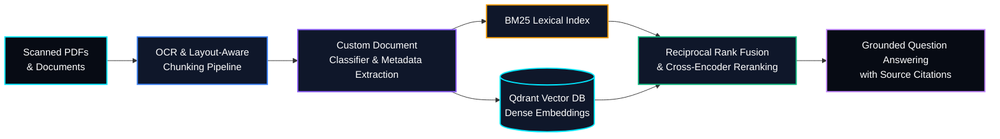

# 🧠 CampusMind — Multimodal OCR & Hybrid RAG Document Intelligence


> **CampusMind** is a Document AI and Hybrid Retrieval-Augmented Generation (RAG) system designed to process academic and enterprise PDFs, scanned notices, and structured documents. It combines OCR, document classification, sparse and dense retrieval, reranking, and citation-backed question answering.

---

## 🏗️ System Architecture



## 🎯 Project Objectives

- Extract usable text and layout information from digital and scanned documents.
- Classify documents and extract useful metadata before indexing.
- Compare lexical search against dense semantic retrieval.
- Improve search relevance using Reciprocal Rank Fusion (RRF) and cross-encoder reranking.
- Generate answers grounded in retrieved document passages with traceable source citations.
- Evaluate retrieval quality and answer faithfulness using reproducible benchmarks.

## 🔧 Core ML & NLP Engineering Focus

### 1. Custom Document Classification

Trains and evaluates a document taxonomy classifier to categorize circulars, syllabi, timetables, research papers, and technical documents before indexing. Metadata extraction can identify useful fields such as document type, title, date, and section.

### 2. Hybrid Retrieval Benchmarking

Combines **BM25 lexical retrieval** with **dense semantic embeddings** to retrieve documents using both exact keyword matches and semantic similarity.

The retrieval pipeline compares:

- BM25 lexical retrieval
- Dense vector retrieval using Qdrant
- Hybrid retrieval using Reciprocal Rank Fusion (RRF)
- Hybrid retrieval with cross-encoder reranking

### 3. Layout-Aware OCR & Chunking

Processes scanned and digital PDFs while preserving section headings, page references, and table boundaries where possible. Structure-aware chunking helps reduce context fragmentation and improves retrieval relevance.

### 4. Citation-Backed Question Answering

Uses retrieved document chunks as evidence for generated answers. Responses include source references such as document names, page numbers, and relevant passages when available. The system should distinguish unsupported questions from those adequately answered by the retrieved evidence.

### 5. Quantitative Retrieval Evaluation

Evaluates retrieval quality using:

- **Recall@K:** Whether relevant documents appear among the top K results.
- **Mean Reciprocal Rank (MRR):** How highly the first relevant result is ranked.
- **Normalized Discounted Cumulative Gain (NDCG):** How effectively the ranking places relevant results near the top.

Compare these metrics across retrieval strategies using the same evaluation queries and relevance labels.

## 🧰 Technology Stack

- **Language:** Python
- **Deep Learning:** PyTorch
- **NLP Models:** Hugging Face Transformers
- **Document Processing:** PDF parsing and OCR tools
- **Sparse Retrieval:** BM25
- **Vector Database:** Qdrant
- **Retrieval Fusion:** Reciprocal Rank Fusion
- **Reranking:** Cross-encoder models
- **API Serving:** FastAPI
- **Evaluation:** Recall@K, MRR, NDCG

*Choose the OCR library, embedding model, and reranker based on document quality, language requirements, latency, and available compute.*

## 📂 Repository Structure

```text
CampusMind/
├── src/
│   ├── ocr_ingest/
│   │   └── pipeline.py           # PDF parsing, OCR and chunking
│   ├── classifier/
│   │   └── train_classifier.py   # Document classification
│   ├── retrieval/
│   │   ├── bm25_search.py        # Sparse lexical retrieval
│   │   ├── dense_search.py       # Qdrant vector retrieval
│   │   └── fusion.py             # Hybrid ranking and RRF
│   └── evaluation/
│       └── benchmark.py          # Recall@K, MRR and NDCG
├── api/
│   └── main.py                   # FastAPI endpoints
├── tests/
├── requirements.txt
└── README.md
```

*This is a suggested repository layout. Adjust filenames and modules to match the actual implementation.*

## 🗺️ Engineering Roadmap

- [x] Hybrid RAG architecture and retrieval evaluation harness design
- [x] OCR ingestion and layout-aware document chunking pipeline
- [ ] Custom document classifier fine-tuning and metadata tagger
- [ ] BM25 versus dense retrieval benchmark
- [ ] Reciprocal Rank Fusion integration and evaluation
- [ ] Cross-encoder reranking benchmark
- [ ] Citation-backed question-answering endpoint
- [ ] FastAPI document ingestion and query service
- [ ] Automated evaluation tests and reproducible benchmarks

*Mark a milestone as completed only when its implementation and evaluation are available in the repository.*

## 🔬 Evaluation Strategy

### Retrieval Evaluation

Evaluate all retrieval approaches on the same held-out query set, with relevance labels prepared independently of model predictions.

| Metric | What it measures |
|---|---|
| Recall@K | Coverage of relevant documents in the top K results |
| MRR | Ranking position of the first relevant result |
| NDCG@K | Ranking quality with graded relevance |
| Retrieval Latency | Time required to retrieve and rank results |

### Answer Quality

Assess generated answers separately from retrieval quality:

- **Groundedness:** Are the claims supported by retrieved evidence?
- **Citation Accuracy:** Do cited sources support the associated claims?
- **Answer Relevance:** Does the response address the user's question?
- **Abstention:** Does the system acknowledge insufficient evidence?

## ⚠️ Project Status

CampusMind is under active development. Planned components should not be presented as completed integrations until they have been implemented and tested.

For reproducibility, document the dataset sources, OCR configuration, embedding model, chunking strategy, retrieval parameters, and evaluation query set. Avoid committing confidential documents, private academic records, or other sensitive data.

---

*CampusMind — Turning complex documents into searchable, explainable knowledge.*
