# ⚙️ PredictiveOps — Time-Series Anomaly Detection & Predictive Maintenance MLOps


> **PredictiveOps** is an industrial time-series Machine Learning and MLOps platform designed to detect sensor anomalies and estimate equipment degradation before failure. It combines causal rolling-window features, point-in-time-correct data processing, walk-forward temporal validation, and monitored model serving.

---

## 🏗️ System Architecture

```mermaid id="p9s3lx"
flowchart LR
    Sensor["Multi-Sensor IoT<br/>Telemetry Stream"] --> Win["Rolling Time-Window<br/>Feature Engineering"]
    Win --> FS[("Point-in-Time<br/>Feature Store")]
    FS --> Split["Walk-Forward<br/>Temporal Validation"]
    Split --> Model["Anomaly Detection<br/>& RUL Prediction"]
    Model --> Serve["Inference Service<br/>Health & Metrics"]
    Serve --> Alert["Early-Warning Alerts<br/>& Prometheus Monitoring"]

    style Sensor fill:#070b14,stroke:#00E7FF,stroke-width:2px,color:#ffffff
    style Win fill:#0f172a,stroke:#3B82F6,stroke-width:2px,color:#ffffff
    style FS fill:#0f172a,stroke:#8B5CF6,stroke-width:2px,color:#ffffff
    style Split fill:#0f172a,stroke:#f59e0b,stroke-width:2px,color:#ffffff
    style Model fill:#0f172a,stroke:#00E7FF,stroke-width:2px,color:#ffffff
    style Serve fill:#0f172a,stroke:#10B981,stroke-width:2px,color:#ffffff
    style Alert fill:#070b14,stroke:#10B981,stroke-width:2px,color:#ffffff
```



## 🎯 Project Objectives

- Detect abnormal equipment behavior from multivariate sensor telemetry.
- Engineer causal time-series features across multiple historical windows.
- Estimate Remaining Useful Life (RUL) when suitable failure and lifecycle labels are available.
- Evaluate models using chronological validation rather than random splitting.
- Serve predictions through a monitored inference service.
- Track service health, prediction latency, and operational metrics with Prometheus.

## 🔧 Core ML & MLOps Engineering Focus

### 1. Rolling-Window Feature Engineering

Extracts historical sensor patterns using configurable time windows, such as `1h`, `6h`, and `24h`, depending on the sampling frequency and prediction horizon.

Feature examples include:

- Lag features from previous observations.
- Rolling means and standard deviations.
- Exponential moving averages (EMA).
- Sensor rate-of-change and first differences.
- Window-based minimums, maximums, and quantiles.

Every feature must use only observations available at its prediction timestamp. Window boundaries and missing-data handling should be documented explicitly.

### 2. Leak-Free Walk-Forward Validation

Uses expanding-window or rolling-window temporal validation instead of random `train_test_split` for time-dependent prediction tasks.

- Train on historical observations.
- Validate on a later time interval.
- Advance the cutoff and repeat.
- Fit preprocessing and model parameters using training data only.
- Apply an appropriate gap or embargo when overlapping windows or delayed labels could cause leakage.

This design helps prevent lookahead bias and produces a more realistic estimate of future performance.

### 3. Anomaly Detection & Remaining Useful Life Modeling

Supports two related but distinct tasks:

**Anomaly Detection**
- Establish statistical or reconstruction-based baselines.
- Evaluate Isolation Forest, reconstruction-error models, or other suitable methods.
- Measure detection quality using metrics such as precision, recall, false alarm rate, and detection delay when ground truth is available.

**Remaining Useful Life (RUL) Prediction**
- Train supervised regression or temporal models when lifecycle and failure labels are available.
- Compare against simple baselines.
- Evaluate with MAE or RMSE and analyze prediction errors across equipment and operating conditions.

Anomaly scores alone do not provide reliable RUL estimates; RUL modeling requires an appropriate target and evaluation protocol.

### 4. Point-in-Time-Correct Feature Store

Maintains consistent feature definitions for training and inference.

- Prevents future observations from entering historical training features.
- Applies the same transformations in offline and online pipelines.
- Tracks feature timestamps, entity identifiers, and data availability.
- Reduces training-serving skew through shared feature logic and validation tests.

A dedicated feature-store product is optional for the initial implementation; a versioned feature pipeline can establish the same core principles.

### 5. Monitored Inference & Early-Warning Alerts

Exposes model predictions through an inference service and exports operational metrics for Prometheus.

Monitoring can include:

- Request counts and prediction latency.
- Service availability and error rates.
- Sensor input quality and missing-value rates.
- Anomaly score distributions and alert volumes.
- Model-quality metrics when delayed ground truth becomes available.

Alert thresholds should be configurable and evaluated against historical data to control excessive false alarms.

## 🧰 Technology Stack

- **Language:** Python
- **Data Processing:** Pandas, NumPy
- **Machine Learning:** Scikit-learn, PyTorch
- **Time-Series Features:** Lag features, rolling statistics, EMA
- **Model Evaluation:** Walk-forward temporal validation
- **Monitoring:** Prometheus
- **Deployment:** Docker, Docker Compose
- **Serving:** A Python inference API, such as FastAPI

*The specific models, serving framework, and monitoring integrations should reflect the actual implementation.*

## 📂 Repository Structure

```text id="q4wn2z"
PredictiveOps/
├── src/
│   ├── ingestion/
│   │   └── telemetry.py          # Sensor data ingestion and validation
│   ├── windowing/
│   │   └── features.py            # Causal lags and rolling statistics
│   ├── validation/
│   │   └── walk_forward.py       # Temporal cross-validation
│   ├── models/
│   │   ├── anomaly.py             # Anomaly detection models
│   │   └── rul.py                 # Remaining Useful Life estimators
│   └── serving/
│       ├── api.py                 # Model inference endpoints
│       └── metrics.py             # Prometheus metrics
├── tests/
├── Dockerfile
├── docker-compose.yml
├── requirements.txt
└── README.md
```

*This is a suggested repository layout. Adjust filenames and modules to match the actual codebase.*

## 📊 Evaluation Metrics

| Metric | Purpose |
|---|---|
| Precision | Fraction of predicted anomalies that are genuine |
| Recall | Fraction of known anomalies detected |
| False Alarm Rate | Frequency of false anomaly alerts |
| Detection Delay | Time between an anomaly beginning and its detection |
| MAE | Average absolute error for RUL estimates |
| RMSE | Penalizes larger RUL prediction errors |
| Inference Latency | Time taken to generate a prediction |

Choose metrics according to the task. For unlabeled anomaly data, document the limitations of evaluating against proxy labels or manually reviewed events.

## 🗺️ Engineering Roadmap

- [x] Multi-sensor temporal pipeline and causal-window specification
- [x] Walk-forward validation harness and future-leakage checks
- [ ] Unsupervised anomaly detection baselines
- [ ] Supervised RUL benchmark using suitable lifecycle labels
- [ ] Containerized inference endpoint
- [ ] Prometheus service-health and latency metrics
- [ ] Configurable early-warning rules and alert evaluation
- [ ] Automated tests for temporal feature correctness
- [ ] Reproducible experiments and model-performance reports

*Keep completed milestones aligned with implemented and tested functionality.*

## 🔬 Data & Reproducibility

For reproducible experiments:

1. Document the dataset source, sensor units, sampling frequency, and equipment identifiers.
2. Define prediction timestamps, forecast horizons, and label-generation rules.
3. Use chronological train, validation, and test partitions.
4. Fit transformations using training data only.
5. Test rolling features against hand-calculated examples to verify timestamp correctness.
6. Report results across multiple temporal splits where feasible.
7. Record model parameters, evaluation results, and dataset versions.

## ⚠️ Project Status

PredictiveOps is under active development. Anomaly detection, RUL estimation, feature storage, and monitoring are separate capabilities that should be validated independently before being integrated into a production workflow.

---

*PredictiveOps — Turning industrial telemetry into actionable maintenance intelligence.*
