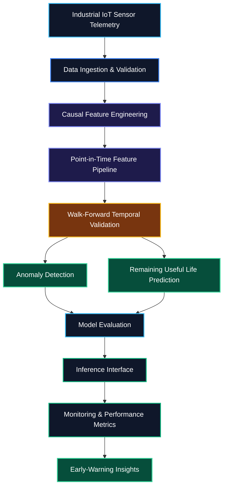

# 📡 PredictiveOps — Industrial Time-Series ML & Predictive Maintenance

<div align="center">

  

  <br/><br/>

  <a href="https://predictiveops-cfjwkerhecznwewyjczzfj.streamlit.app/" target="_blank">
    
  </a>

  <br/><br/>

  
  
  
  
  
  

</div>

---

## 🌐 Live Interactive Deployment

Explore PredictiveOps through its live web application.

**[🚀 Launch PredictiveOps Live Platform](https://predictiveops-cfjwkerhecznwewyjczzfj.streamlit.app/)**

PredictiveOps explores how time-series machine learning can help identify unusual industrial sensor behavior and support predictive maintenance through time-aware feature engineering, model evaluation, and monitoring.

> **Note:** The live Streamlit application provides the user-facing interface. API availability and individual backend capabilities depend on the current deployment configuration.

---

## 📌 Overview

**PredictiveOps** is an industrial time-series Machine Learning and MLOps project focused on detecting abnormal sensor behavior and exploring predictive maintenance workflows.

The project is designed to process multivariate sensor telemetry, engineer historical features, evaluate models using chronological validation, and support reproducible inference workflows.

Rather than relying exclusively on random train-test splits or generic accuracy metrics, PredictiveOps emphasizes temporal correctness, future-data leakage prevention, and evaluation strategies suited to time-dependent industrial data.

Its two primary modeling directions are:

- **Anomaly Detection:** Identifying unusual patterns in industrial sensor measurements.
- **Remaining Useful Life (RUL) Prediction:** Estimating the remaining operating time or cycles before equipment failure when suitable lifecycle labels are available.

### 🎯 Project Objectives

- Process multivariate industrial sensor telemetry.
- Engineer lag, rolling-window, and exponential moving average features.
- Prevent future-data leakage during feature engineering and evaluation.
- Evaluate models using chronological and walk-forward validation.
- Explore anomaly detection and supervised RUL prediction.
- Design reproducible model-training and evaluation workflows.
- Support inference and operational monitoring through suitable application interfaces.

---

## 🏗️ End-to-End Pipeline & Architecture

<div align="center">

  

</div>

### System Architecture



The architecture illustrates the intended workflow from sensor telemetry to model evaluation and inference. Individual components should be considered implemented only when supported by the repository code and tests.

---

## 🔧 Core ML & MLOps Capabilities

### 1. 📈 Causal Time-Series Feature Engineering

Transforms historical sensor measurements into features that capture equipment behavior over time.

Potential features include:

- Lag features from previous observations.
- Rolling means and standard deviations.
- Exponential moving averages (EMA).
- Sensor rate-of-change and first differences.
- Rolling minimums, maximums, and quantiles.
- Configurable historical observation windows.

**Engineering focus:** Features at a prediction timestamp should use only information available at that time.

### 2. 🔒 Leak-Free Temporal Validation

Random train-test splits can produce misleading results when observations are time-dependent.

PredictiveOps emphasizes chronological evaluation through:

- Historical training intervals.
- Validation on later time periods.
- Repeated walk-forward evaluation.
- Training-only preprocessing and transformation fitting.
- Appropriate gaps between splits when overlapping windows or delayed labels create leakage risks.
- A final chronological test set for unbiased evaluation.

### 3. 🚨 Industrial Anomaly Detection

Anomaly detection helps identify sensor behavior that differs significantly from established operating patterns.

Potential approaches include:

- Statistical threshold-based baselines.
- Isolation Forest.
- Reconstruction-error-based anomaly detection.
- PyTorch-based models when justified by the data and task.

Evaluation can include precision, recall, false-alarm rate, detection delay, and operational alert volume when appropriate labels or event records are available.

### 4. ⏳ Remaining Useful Life (RUL) Prediction

RUL prediction is a separate supervised learning task that estimates the remaining time or operating cycles before equipment failure.

A reliable workflow requires:

- Appropriate equipment lifecycle and failure labels.
- Clearly defined prediction targets.
- Simple regression baselines.
- Chronological model evaluation.
- Error analysis across equipment units and operating conditions.

An anomaly score alone does not constitute a reliable RUL estimate.

### 5. 🧪 Reproducible ML Evaluation

Reliable machine learning requires more than training a model once.

The project emphasizes:

- Consistent feature definitions across training and inference.
- Documented data preprocessing.
- Reproducible evaluation splits.
- Comparisons against simple baselines.
- Explicit reporting of datasets, parameters, and measured results.
- Automated tests for important feature and validation behaviors.

### 6. 📊 Inference Monitoring & Observability

A production-oriented predictive maintenance workflow can incorporate service-level monitoring through Prometheus and an inference API.

Useful operational metrics include:

- Request volume and inference latency.
- Service availability and error rates.
- Sensor input validation failures.
- Missing-value rates.
- Anomaly score distributions.
- Alert volume and model-quality metrics when ground truth becomes available.

Monitoring integrations and alerting rules should be documented as implemented only after they have been configured and tested.

---

## 📊 Evaluation Metrics

| Metric | Purpose |
|---|---|
| **Precision** | Measures how many predicted anomalies are genuine. |
| **Recall** | Measures how many known anomalies are detected. |
| **False Alarm Rate** | Tracks incorrect anomaly alerts. |
| **Detection Delay** | Measures the delay between anomaly onset and detection. |
| **MAE** | Measures average absolute error for RUL prediction. |
| **RMSE** | Penalizes larger RUL prediction errors. |
| **Inference Latency** | Measures prediction response time. |
| **Request Error Rate** | Tracks failed inference requests. |

Metrics should be selected according to the task and the available ground truth. Actual benchmark scores should be reported only after running the evaluation pipeline.

---

## 🧰 Technology Stack

| Component | Technology | Purpose |
|---|---|---|
| Programming Language | Python 3.11 | Core implementation |
| Data Processing | Pandas, NumPy | Data preparation |
| Machine Learning | Scikit-learn, PyTorch | Modeling and evaluation |
| Feature Engineering | Lag features, rolling statistics, EMA | Time-series representation |
| Temporal Validation | Walk-forward validation | Chronological evaluation |
| Web Application | Streamlit | Interactive user interface |
| API Serving | FastAPI, Uvicorn | Inference endpoints, where configured |
| Monitoring | Prometheus | Service metrics, where configured |
| Testing | Pytest | Automated testing |
| CI/CD | GitHub Actions | Automated validation |
| Containerization | Docker, Docker Compose | Reproducible deployment, where configured |
| Version Control | Git, GitHub | Source management |

The final technology stack should match the dependencies and integrations actually present in the repository.

---

## 💻 Local Setup & Execution

### Prerequisites

- Python 3.11
- Git
- pip
- PowerShell, Command Prompt, or a Bash-compatible terminal

### 1. Clone the Repository

```powershell
git clone https://github.com/Aditya70-creator/PredictiveOps.git
cd PredictiveOps
```

### 2. Create a Virtual Environment

**Windows PowerShell**

```powershell
python -m venv .venv
.\.venv\Scripts\Activate.ps1
```

**Linux / macOS**

```bash
python3 -m venv .venv
source .venv/bin/activate
```

### 3. Install Dependencies

```bash
python -m pip install --upgrade pip
pip install -r requirements.txt
```

### 4. Launch the Streamlit Application

If the Streamlit entry point is `app.py`, run:

```bash
streamlit run app.py
```

If your application entry point is located elsewhere, replace `app.py` with the actual path, for example `streamlit run app/dashboard.py`.

### 5. Run Automated Tests

If the repository contains a configured Pytest suite:

```bash
pytest -v
```

### 6. Run the Inference API (Optional)

If the repository includes the configured FastAPI entry point `api/main.py`:

```bash
uvicorn api.main:app --reload --port 8000
```

The API command is optional and assumes that the specified module and application object exist.

---

## 🔬 Reproducibility & Engineering Practices

PredictiveOps follows practical machine learning engineering principles:

- **Temporal correctness:** Avoid using future observations to construct historical features.
- **Leakage prevention:** Fit preprocessing transformations on training data only.
- **Chronological evaluation:** Preserve time ordering during validation and testing.
- **Feature consistency:** Reuse compatible feature transformations during training and inference.
- **Baseline comparison:** Evaluate complex models against simpler alternatives.
- **Transparent evaluation:** Document data sources, metrics, temporal splits, and assumptions.
- **Automated testing:** Verify feature calculations, validation logic, and application behavior.
- **Responsible monitoring:** Evaluate false alarms and operational limitations before deployment.

---

## 🗺️ Engineering Roadmap

The roadmap describes planned development milestones. Update completion status as each feature is implemented and tested.

- [x] Initial time-series pipeline design
- [x] Initial causal-window and temporal-validation specifications
- [ ] Multivariate sensor feature pipeline with leakage tests
- [ ] Statistical anomaly detection baselines
- [ ] Isolation Forest benchmarking
- [ ] Supervised RUL benchmark with suitable lifecycle labels
- [ ] Walk-forward evaluation reports
- [ ] Feature correctness and data validation tests
- [ ] Inference endpoint validation
- [ ] Prometheus service-health and latency metrics
- [ ] Configurable early-warning rules
- [ ] Experiment tracking and model versioning
- [ ] Containerized deployment, if required
- [ ] Operational monitoring dashboard

---

## 🔐 Security & Responsible Use

PredictiveOps is intended for educational, research, and industrial predictive-maintenance experimentation.

- Use authorized datasets and protect sensitive industrial telemetry.
- Never commit credentials, API keys, or private configuration files.
- Validate incoming sensor data before model inference.
- Document dataset limitations and model assumptions.
- Evaluate false alarms and missed detections before operational use.
- Treat model predictions as decision-support signals rather than definitive proof of equipment failure.

---

## 🤝 Contributing

Contributions, bug reports, and engineering improvements are welcome.

1. Fork the repository.
2. Create a feature branch.
3. Implement your changes.
4. Run relevant tests.
5. Submit a pull request describing the changes.

Please include tests when modifying feature engineering, temporal validation, model behavior, or inference logic.

---

## 📄 License

This project is intended to use the MIT License. See [`LICENSE`](./LICENSE) for the applicable terms.

---

## 👨‍💻 Author

**Aditya Mitra**

- **GitHub:** [@Aditya70-creator](https://github.com/Aditya70-creator)
- **Repository:** [PredictiveOps](https://github.com/Aditya70-creator/PredictiveOps)
- **Live Application:** [PredictiveOps on Streamlit Cloud](https://predictiveops-cfjwkerhecznwewyjczzfj.streamlit.app/)

---

<div align="center">

  **PredictiveOps**

  *Turning industrial telemetry into actionable maintenance intelligence.*

</div>
